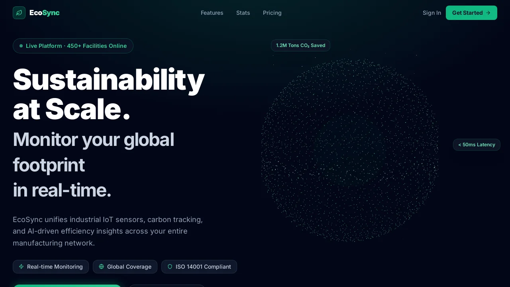
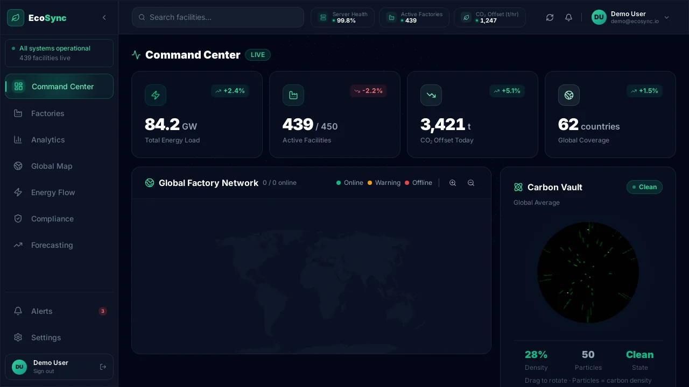
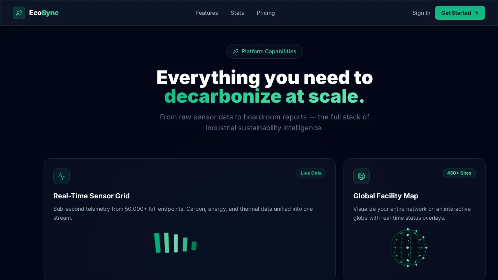

# EcoSync

**EcoSync** منصة ويب لمراقبة الاستدامة والطاقة في المنشآت الصناعية — لوحة تحكم IoT تجمع بيانات الطاقة والكربون والامتثال في مكان واحد، بواجهة حديثة وربط مع Supabase.

**Live demo:** [eco-sync-git-main-sara-ismails-projects.vercel.app](https://eco-sync-git-main-sara-ismails-projects.vercel.app/)

**حساب تجريبي:** `demo@ecosync.io` / `demo1234`

---

## 1. صورة / فيديو للمشروع وهو شغال

### فيديو سريع

[▶ Demo walkthrough (no cursor)](docs/demo-walkthrough.mp4)

### الصفحة الرئيسية



### لوحة التحكم (Command Center)



### أبرز القدرات



---

## 2. المشكلة التي يحلها والفئة المستهدفة

### المشكلة

الشركات اللي عندها مصانع أو مواقع متعددة غالباً بتواجه:

- بيانات الطاقة والكربون **مبعثرة** بين أنظمة وأجهزة مختلفة
- صعوبة متابعة **حالة كل منشأة** (أونلاين / تحذير / أوفلاين) في لحظة واحدة
- تقارير الامتثال البيئي (مثل ISO 14001 و GHG Protocol) بتاخد وقت وجهد يدوي
- تأخر اكتشاف **الشذوذ والتنبيهات** قبل ما تتحول لمشكلة تشغيلية أو تكلفة أعلى

EcoSync بيوفر **نظرة موحّدة**: خريطة عالمية للمنشآت، مقاييس طاقة وكفاءة مباشرة، حالة امتثال، وتنبيهات — من لوحة واحدة.

### الفئة المستهدفة

| الفئة | ليه EcoSync؟ |
| --- | --- |
| **مدراء الاستدامة والطاقة** | متابعة الكربون والطاقة وخطط net-zero |
| **مشغّلو المنشآت الصناعية** | حالة المواقع، الأحمال، والتنبيهات لحظياً |
| **فرق الامتثال والجودة** | تتبع المعايير البيئية وتقارير الجاهزية |
| **شركات متعددة المواقع** | رؤية جغرافية موحّدة لكل الشبكة |

---

## 3. أهم الفيتشرز والتحديات اللي اتحلت

### أهم الفيتشرز اللي اتطوّرت

- **Command Center** — KPIs (حمل الطاقة، منشآت نشطة، تعويض CO₂، تغطية عالمية) + خريطة + مخطط طاقة مباشر + تنبيهات
- **إدارة المصانع (Factories)** — عرض وإضافة منشآت وتصدير البيانات (CSV / JSON)
- **Analytics** — رسوم بيانية لاتجاهات الطاقة والكربون والكفاءة
- **Global Map** — توزيع جغرافي للمنشآت مع حالة التشغيل
- **Energy Flow** — تدفق الطاقة لكل منشأة وعلى مستوى الشبكة
- **Compliance** — متابعة معايير الامتثال وحالة النجاح/الفشل
- **Forecasting** — اتجاهات وأهداف مستقبلية
- **Alerts** — إشعارات وتنبيهات سريعة من الشريط الجانبي
- **Landing + Auth** — صفحة تسويقية بمشاهد 3D، وتسجيل دخول مع حماية للـ dashboard
- **Settings & Profile** — الملف الشخصي وإعدادات الحساب

### التحديات اللي اتحلت

| التحدي | الحل |
| --- | --- |
| **Infinite re-render في لوحة التحكم** مع React 19 + Zustand | فصل selectors (قيمة واحدة لكل hook بدل إرجاع object جديد كل مرة) وتحميل البيانات مرة واحدة في الـ router |
| **أداء الواجهة مع خرائط ورسوم و3D** | Lazy loading للشاشات الثقيلة، وThree.js / R3F للمشاهد البصرية بدون ما تثقل الصفحة كلها من الأول |
| **بيانات حقيقية من Backend** | دمج Supabase للمصانع والتنبيهات ومعايير الامتثال، مع معالجة أخطاء الاتصال في الواجهة |
| **تجربة مستخدم مترابطة** | حماية المسارات (Protected Route)، حالة عامة بـ Zustand، وحركات Framer Motion للانتقالات |
| **نشر على Vercel** | تثبيت Node 20 و`legacy-peer-deps` لتفادي تعارضات الحزم أثناء الـ build |

---

## Tech Stack

- **React 19** + **TypeScript** + **Vite**
- **Tailwind CSS** + **Framer Motion**
- **Zustand** + **React Router**
- **Supabase** (factories, alerts, compliance)
- **Recharts** + **React Three Fiber**
- **React Hook Form** + **Zod**

---

## هيكل المشروع

- `src/views/` — الصفحات (auth, home, dashboard, settings, profile, error)
- `src/components/` — مكوّنات UI و 3D مشتركة
- `src/hooks/` — حالة التطبيق والـ feature hooks
- `src/services/` — منطق Supabase / API
- `src/config/` — الثيم وإعدادات التطبيق
- `src/constants/` — التنقل والبيانات الثابتة
- `src/router/` — المسارات وحماية الـ dashboard
- `docs/` — صور الـ demo المستخدمة في الـ README

---

## التشغيل محلياً

```bash
npm install
npm run dev
```

Build للإنتاج:

```bash
npm run build
npm run preview
```
